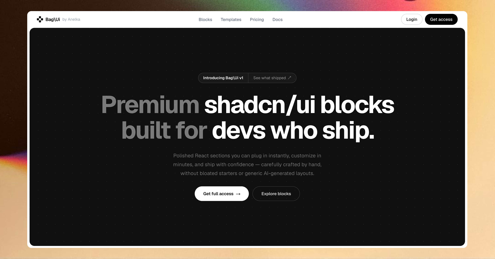

<p align="center">
  
</p>

<h1 align="center">BagUi</h1>

<p align="center">
  A modern, open-source registry of UI components, blocks, and ready-to-use sections — built to help developers ship polished interfaces faster with shadcn/ui.
</p>

<p align="center">
  <a href="https://bagui.pro"><strong>Live Site</strong></a> ·
  <a href="#-getting-started">Getting Started</a> ·
  <a href="#-contributing">Contributing</a> ·
  <a href="#-project-structure">Project Structure</a>
</p>

<p align="center">
  
  
  
  
  
</p>

<p align="center">
  
</p>

<p align="center"><strong>Built by Anelka Bag</strong></p>

---

## ✨ About

**BagUi** is an open-source component registry offering a growing collection of production-ready UI blocks, sections, and components — navbars, heroes, footers, pricing tables, CTAs, and more — built with a strong focus on clean design and smooth animations.

### Tech Stack

- [Next.js](https://nextjs.org) — React framework
- [TypeScript](https://www.typescriptlang.org) — type safety
- [Tailwind CSS](https://tailwindcss.com) — utility-first styling
- [shadcn/ui](https://ui.shadcn.com) — component foundation
- [Framer Motion](https://www.framer.com/motion) — animations

---

## 🚀 Getting Started

### Prerequisites

- [Node.js](https://nodejs.org) `v18+`
- [npm](https://www.npmjs.com) (or `pnpm` / `yarn`, if you prefer)
- [Git](https://git-scm.com)

### 1. Clone the repository

```bash
git clone https://github.com/anelkabag/bagui.git
cd bagui
```

### 2. Install dependencies

```bash
npm install
```

### 3. Run the development server

```bash
npm run dev
```

The app will be available at [http://localhost:3000](http://localhost:3000).

---

## 🤝 Contributing

BagUi is open source, and contributions are very welcome! Whether it's a new component, a bug fix, or a documentation improvement — here's how to get started.

### 1. Fork & branch

```bash
git checkout -b feat/my-new-component
```

### 2. Add your component to the registry

Components live in two places:

| Type          | Path                                                 |
| ------------- | ---------------------------------------------------- |
| Blocks        | [`registry/default/blocks`](registry/default/blocks) |
| UI components | [`registry/default/ui`](registry/default/ui)         |

**Rules to follow:**

- If the component's category doesn't exist yet, create a new folder for it.
- Blocks should be organized by category, e.g.:
  - [`registry/default/blocks/navbar`](registry/default/blocks/navbar)
  - [`registry/default/blocks/hero`](registry/default/blocks/hero)
  - [`registry/default/blocks/feature`](registry/default/blocks/feature)
- Place the component file in the right folder, e.g.:
  - `registry/default/blocks/navbar/navbar1.tsx`

### 3. Create the component file

```tsx
export default function Navbar1() {
  return (
    <nav className="flex items-center justify-between p-4">
      <div className="font-semibold">BagUi</div>
      <div className="flex gap-3">Home</div>
    </nav>
  );
}
```

Keep it clean, reusable, and consistent with the project's existing conventions.

### 4. Register it in `registry.json`

Add an entry for your component in the `items` section of [`registry.json`](registry.json):

```json
{
  "name": "navbar1",
  "type": "registry:block",
  "title": "Navbar Example 1",
  "description": "Modern and responsive navigation.",
  "files": [
    {
      "path": "registry/default/blocks/navbar/navbar1.tsx",
      "type": "registry:block",
      "target": "components/blocks/navbar1.tsx"
    }
  ],
  "access": {
    "tier": "free"
  }
}
```

**Checklist before saving:**

- [ ] `name` is unique across the registry
- [ ] `path` points to the correct file under [`registry/default`](registry/default)
- [ ] `target` matches the expected destination in a consumer project
- [ ] `access.tier` is set to `free` or `pro`

### 5. Verify & build

```bash
npm run build
npm run registry:build
```

The first command makes sure the app compiles correctly. The second prepares and publishes your component to the registry.

### 6. Open a pull request

1. Commit your changes with a clear message
2. Push your branch
3. Open a PR including:
   - the component name
   - what it adds / fixes
   - screenshots or a short screen recording, if possible

## Release email notifications

BagUI listens for successful GitHub `deployment_status` events from Vercel.
Only deployments marked as production are accepted. The publisher then reads
the canonical live registry at `https://www.bagui.pro/r/registry.json`; the
first synchronization records the existing catalog as a baseline without
emailing it. Later additions create unique campaigns and durable per-recipient
delivery jobs in Supabase. Ordinary resource updates, preview deployments, and
local development do not create campaigns.

Before enabling production sends:

1. Apply [`supabase/release-notifications.sql`](supabase/release-notifications.sql)
   to the production Supabase project. The migration reuses the existing
   delivery table as the persistent queue and enables Supabase `pg_net` and
   `pg_cron`. New campaigns enqueue an asynchronous HTTP dispatch in the same
   database transaction. A conditional once-per-minute Supabase recovery task
   wakes due or expired deliveries if an HTTP dispatch or worker was
   interrupted; this is not a Vercel Cron Job.
2. Set these server-side environment variables in the production deployment:
   `SUPABASE_SERVICE_ROLE_KEY`, `RESEND_API_KEY`, `RESEND_WEBHOOK_SECRET`,
   `RELEASE_NOTIFICATION_DISPATCH_SECRET` (at least 32 random bytes),
   `RELEASE_NOTIFICATION_WORKER_SECRET` (at least 32 random bytes),
   `NOTIFICATION_TOKEN_SECRET` (at least 32 random bytes), and
   `RELEASE_NOTIFICATION_ADMIN_EMAILS` (comma-separated admin email addresses).
   `BAGUI_SUPPORT_EMAIL` is optional and is used as the reply-to address.
3. Add a GitHub Actions repository secret named
   `RELEASE_NOTIFICATION_DISPATCH_SECRET` with the same value as the Vercel
   dispatch secret. The workflow at
   [`.github/workflows/release-notifications.yml`](.github/workflows/release-notifications.yml)
   must be merged to the default branch to receive GitHub `deployment_status`
   events, then calls
   `https://www.bagui.pro/api/notifications/publish`. Confirm the Vercel GitHub
   integration creates GitHub deployments with `production_environment: true`
   for production. The publisher independently checks the event and fetches
   the public production registry before creating campaigns.
4. In the Supabase SQL editor, store the worker URL and the same worker secret
   configured in Vercel in Vault:

   ```sql
   select vault.create_secret(
     'https://www.bagui.pro/api/notifications/worker',
     'release_notification_worker_url'
   );
   select vault.create_secret(
     '<same value as RELEASE_NOTIFICATION_WORKER_SECRET>',
     'release_notification_worker_secret'
   );
   ```

   The database dispatches workers through `pg_net`; the worker authenticates
   with the shared secret. Keep this value out of client-side configuration.
5. Confirm that `news.bagui.pro` is listed as **verified** with sending enabled
   in the Resend dashboard. Public DNS currently publishes the Resend DKIM and
   sending/SPF records, but DNS alone cannot confirm the Resend account status.
   No DMARC record was found for `news.bagui.pro` or `bagui.pro`; review your
   DMARC policy with the domain administrator as a separate deliverability step.
   The worker checks the Resend account before claiming or sending any email.
6. Configure a Resend webhook at
   `https://www.bagui.pro/api/webhooks/resend` for `email.sent`,
   `email.delivered`, `email.failed`, `email.bounced`, and `email.complained`,
   then store its signing secret as `RESEND_WEBHOOK_SECRET`.

The deployment callback does not send emails or wait for delivery. Supabase
`pg_net` dispatches the secured Next.js worker after a campaign is committed.
The worker processes at most 50 recipients per invocation, applies controlled
Resend concurrency, and relies on delivery leases plus exponential retry
backoff. Supabase `pg_cron` is only a recovery path for pending work, so Vercel
Hobby does not need any scheduled function. Users are opted out by default;
they can opt in or out under **Account → Email preferences**. Admins listed in
`RELEASE_NOTIFICATION_ADMIN_EMAILS` can inspect campaigns at
`/admin/release-notifications` and retry eligible temporary failures.

---

## 📁 Project Structure

```text
bagui/
├── registry/
│   └── default/
│       ├── blocks/    # UI blocks & page sections (navbar, hero, footer, ...)
│       └── ui/         # Reusable base UI components
├── registry.json       # Registry manifest — lists all available components
└── public/              # Static assets
```

---

## ✅ Quick Checklist for a New Component

- [ ] File created in the correct folder
- [ ] Component renders and works correctly
- [ ] Component added to [`registry.json`](registry.json)
- [ ] `npm run build` passes
- [ ] `npm run registry:build` passes
- [ ] Pull request opened

---

## 💡 Tips

- Keep components simple, clean, and well named.
- Follow the existing structure to stay consistent with the rest of the project.
- Introducing a new block type? Create the matching category under [`registry/default/blocks`](registry/default/blocks) first.
- When in doubt, look at how similar existing components are structured before writing your own.

---

## 📄 License

This project is licensed under the [MIT License](LICENSE).

---

<p align="center">
  Made with ❤️ by <a href="https://github.com/anelkabag">Anelka Bag</a> — contributions welcome!
</p>
